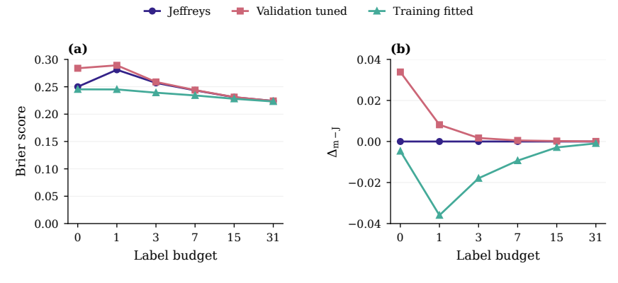
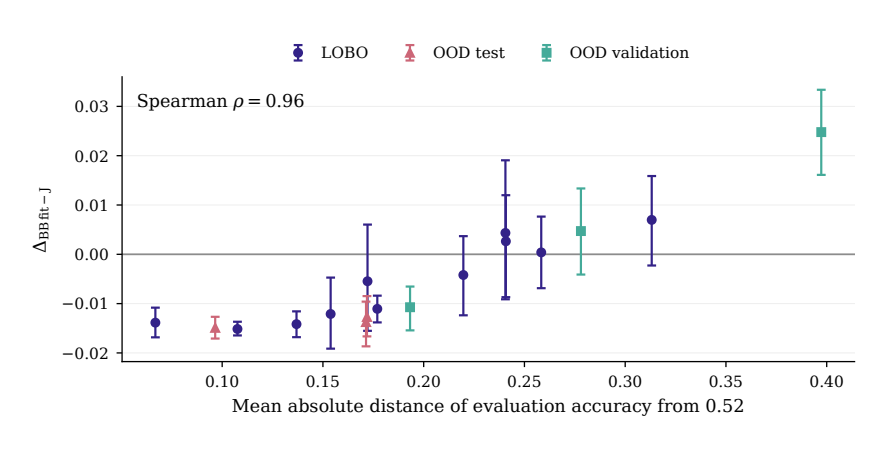

<h1 align="center">What Transfers to a New Benchmark?</h1>
<p align="center"><em>Priors, Not Item Estimates, for Label-Efficient LLM Evaluation</em></p>
<p align="center">Arshia Teymourtash · Ankit Grover<br>KTH Royal Institute of Technology, Stockholm</p>
<p align="center">40th Conference on Neural Information Processing Systems (NeurIPS 2026), The Predictive AI Evaluation Competition at NeurIPS 2026</p>

<p align="center">
<a href="paper/eandd-drafts/eandd-v100.pdf"><b>Paper (PDF)</b></a> ·
<a href="paper/neurips_2026/eandd.tex">LaTeX source</a> ·
<a href="dist/submission.zip">Final Codabench entry <code>1005155</code></a> ·
<a href="paper/eandd/PROGRESS.md">Results log</a>
</p>

---

## Overview
Predicting how an LLM answers each item of a new benchmark from a few labelled answers is useful only if what is learned from past benchmarks carries over.
We test what carries over with one controlled design: the **same models, tasks and label order**, changing only **where the prior comes from**
(fixed in advance, tuned on validation, or fitted on training benchmarks), in an online simulation of the Predictive AI Evaluation Competition.

<p align="center"></p>
<p align="center"><sub><b>Figure 1.</b> Brier score (left) and the difference to Jeffreys (right) per label budget on the three unseen test benchmarks. The prior's source matters at zero to three labels and has faded by 31.</sub></p>

## Setting
- **Data:** a binary response matrix with subjects as rows and items as columns. A *task* is one subject on one benchmark.
- **Online simulation:** labels are revealed one at a time (budgets 0, 1, 3, 7, 15, 31); the predictor updates from them. Offline means fitted on training benchmarks beforehand.
- **Splits:** 17 benchmarks, split into 11 training, 3 validation and 3 test benchmarks (disjoint column blocks). Validation and test are out of distribution (OOD); the in-distribution (ID) evaluation holds out subjects within the training benchmarks.
- **Metric:** Brier ALC (area under the learning curve), weights 0.1, 0.2, 0.2, 0.2, 0.2, 0.1. Every difference is written Δ<sub>a−b</sub> = ALC(a) − ALC(b); negative favours *a*.

## Models
| Model | Prediction | Prior parameters |
|---|---|---|
| **Beta-Binomial** | posterior mean $(\alpha+k)/(\alpha+\beta+n)$ for a task with $k$ of $n$ labels correct | $(\alpha,\beta)$; Jeffreys is $(\tfrac12,\tfrac12)$ |
| **Rasch** | $p_{ij}=\sigma(\theta_i-b_j)$, $b_j=\delta_j-\mu_{d(j)}$ (ability, item deviation, benchmark rate) | $m_0$, widths $\sigma_\mu,\sigma_\theta,\sigma_\delta$ |
| **Kernel Rasch** | Rasch with item deviations correlated by BGE-M3 embedding similarity | adds kernel weight $\rho$ and temperature $T$ |

## Results
Δ<sub>m−J</sub> (Brier ALC difference to the Jeffreys Beta-Binomial; negative is better), competition-shaped draws.

| Prior source | Model | ID | OOD validation | OOD test |
|---|---|---:|---:|---:|
| Fixed in advance | Rasch | −0.0073 | +0.0031 | −0.0102 |
| | Kernel Rasch | −0.0072 | +0.0029 | −0.0105 |
| Tuned on validation | Beta-Binomial | +0.0041 | **−0.0015** | +0.0055 |
| | Rasch | −0.0024 | +0.0004 | −0.0032 |
| | Kernel Rasch | +0.0001 | −0.0003 | −0.0024 |
| Fitted on training | Beta-Binomial | **−0.0090** | +0.0079 | **−0.0138** |
| | Rasch | −0.0081 | +0.0052 | −0.0119 |
| | Kernel Rasch | −0.0063 | +0.0036 | −0.0118 |

Offline estimates that keep their fitted item values reach **−0.0852** on the ID evaluation and nothing extra on unseen benchmarks.

**Key findings**
1. **What transfers is a prior, not item-level estimates.** Where fitted values apply, offline fitting is worth a very large gain; on unseen benchmarks it is worth none.
2. **The prior's gain is modest and uneven:** −0.005 averaged over the 17 benchmarks, −0.004 over all 680 choices of three held-out benchmarks, and a loss in 17.5% of them. The 0.014 test gain is a favourable split.
3. **When it helps:** the prior pulls predictions toward a typical accuracy of about 52%, so it helps on benchmarks of typical difficulty and hurts on much easier or much harder ones (Spearman 0.96 between the gain and the distance from 0.52, over 17 benchmarks).
4. **Item content:** neural probes on item embeddings carry a small rank signal for difficulty (benchmark-macro Spearman 0.09 and 0.10 against 0.03 for a random baseline; on the test benchmarks alone the Rasch-target probe is 0.06, below the random control), and using it as the Rasch prior mean improves Brier ALC by only about 0.0004.
5. **Label sharing across subjects is untested:** each competition-shaped draw has one subject per benchmark.

<p align="center"></p>
<p align="center"><sub><b>Figure 2.</b> Gain of the fitted prior against how far a benchmark's accuracy lies from the prior mean (17 benchmarks).</sub></p>

## Limitations
Three test benchmarks; test scores were inspected repeatedly while building the models (all selection used validation); the explanation for when the prior helps was found after seeing results, so it explains rather than predicts; the competition's hidden leaderboard was not used as evidence.

## Competition entry
The final Codabench submission is **`1005155`**: [`dist/submission.zip`](dist/submission.zip), a Beta-Binomial predictor with a fixed prior and subject-level shrinkage
(source: `organized/submission/legacy/submission/`). The paper's own model, a Beta-Binomial with the training-fitted prior (α = 1.92, β = 1.76), is a different predictor: its results come from the online simulation, not from the leaderboard.

```bash
python scripts/build_submission.py
python reference/starting_kit/tools/check_submission_zip.py dist/submission.zip
```

## Repository layout
| Path | Contents |
|---|---|
| `paper/neurips_2026/eandd.tex` | Paper source; generated table inputs `eandd_*.tex`; `figures/eandd/` |
| `paper/eandd/` | `assemble.py` (tables from the CSVs), `data/` (small result tables), `PROGRESS.md` (running results log) |
| `paper/build-eandd.sh` | Rebuilds the tables, compiles the paper, saves the next numbered draft in `paper/eandd-drafts/` |
| `organized/testing/eandd/` | Online simulation, models, probes, robustness and split-sensitivity code |
| `organized/submission/` | Competition submissions and trained checkpoints |
| `literature/`, `docs/` | Papers used and design notes; the full development log is `docs/development-notes.md` |
| `Final-plan.md`, `Reviewer-updates-plan.md` | Work packages and the response to the workshop review |

## Reproducing
```bash
uv venv .venv && uv pip install --python .venv/bin/python -e '.[dev,experiment]'
paper/build-eandd.sh        # needs tectonic at .tools/tectonic/tectonic (not in git)

# one run of the online simulation
.venv/bin/python organized/testing/eandd/run_replay.py --run my-check --shape competition --role test \
    --models jeffreys,rasch-retuned,kernel-old --no-preds
```
Tables and figures are rebuilt from the committed CSVs in `paper/eandd/data/`. Run names are new every time: `save_run` refuses to overwrite.

## Data
The competition response data cannot be redistributed and is not in this repository. The experiments read it from local paths
(`AIMS_RESPONSES`, `AIMS_REPLAY_CACHE`, `AIMS_EMBEDDINGS`, `AIMS_EANDD_DATA`; see `docs/collaboration-setup.md`).
Included: the frozen draws (`paper/eandd/data/draws.parquet`), the small result tables and the saved checkpoints.

## Contributing and license
See [`CONTRIBUTING.md`](CONTRIBUTING.md) and [`LICENSE`](LICENSE) (MIT). Do not commit credentials, hidden outcomes or data whose licence does not allow redistribution.
